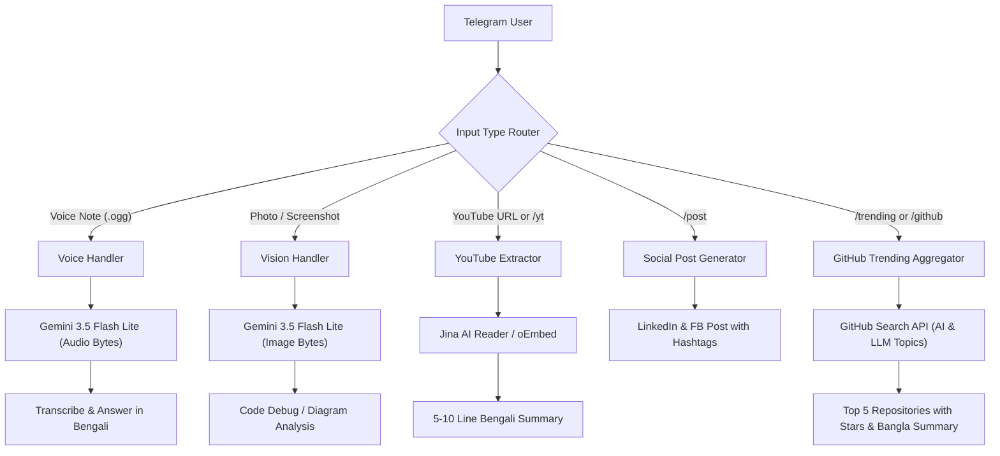

# Technical Specification: 3 Advanced Skills Expansion for 1st Agent

**Document ID:** `SPEC-2026-SKILLS-002`  
**Date:** 2026-11-07  
**Status:** APPROVED FOR IMPLEMENTATION  

---

## 1. Objectives & Overview

This specification details the architecture, data models, and implementation steps for adding three major capability modules to `@Sharif_1st_Agent_bot`:

1. **Skill 1: YouTube Summarizer & LinkedIn Post Generator**
   - Automatically detects YouTube URLs or accepts `/yt <url>` commands.
   - Extracts title, metadata, and transcript/content via Jina AI / oEmbed.
   - Generates 5-10 lines structured Bengali summary with key insights.
   - Provides `/post <topic_or_news_id>` command to craft high-impact LinkedIn and Facebook tech posts with hooks, takeaways, and hashtags.

2. **Skill 2: GitHub Trending AI & Open-Source Projects Tracker**
   - Fetches top trending artificial intelligence and LLM repositories from GitHub using public API query endpoints.
   - Provides `/trending` or `/github` command to view top 5 active repositories with star velocity, translated Bengali descriptions, and direct links.
   - Saves tracked repositories into `memory.db` table `github_trending`.

3. **Skill 3: Multimodal Vision & Voice Note Intelligence**
   - **Photo/Vision Handler (`filters.PHOTO | filters.Document.IMAGE`):** Receives code screenshots, error logs, and diagrams. Passes image bytes directly to Gemini 3.5 Flash Lite to diagnose bugs and provide solutions in Bengali.
   - **Voice Note Handler (`filters.VOICE | filters.AUDIO`):** Receives voice messages (.ogg/.mp3), passes audio directly to Gemini 3.5 Flash Lite for native transcription and intelligent contextual responses in Bengali.

---

## 2. Architecture & Data Flow



---

## 3. Database Schema Updates

New table in `memory.db`:

```yaml
database:
  file: "memory.db"
  tables:
    github_trending:
      columns:
        id: "INTEGER PRIMARY KEY AUTOINCREMENT"
        fetch_date: "TEXT NOT NULL"
        repo_name: "TEXT NOT NULL"
        repo_url: "TEXT UNIQUE NOT NULL"
        stars: "INTEGER DEFAULT 0"
        description: "TEXT"
        description_bn: "TEXT"
        language: "TEXT"
        created_at: "TIMESTAMP DEFAULT CURRENT_TIMESTAMP"
```

---

## 4. Implementation Plan & File Modifications

1. `agent_tools.py`:
   - Add `init_db()` migration for `github_trending` table.
   - Implement `fetch_github_trending_ai()` function.
   - Implement `extract_youtube_content(url)` function.
   - Implement `generate_social_post(topic_or_news_id)` function.

2. `bot.py`:
   - Register photo handler: `MessageHandler(filters.PHOTO, handle_photo)`.
   - Register voice handler: `MessageHandler(filters.VOICE, handle_voice)`.
   - Register YouTube command & auto-detect: `CommandHandler("yt", handle_youtube)`.
   - Register Social Post command: `CommandHandler("post", handle_post)`.
   - Register GitHub Trending command: `CommandHandler(["trending", "github"], handle_trending)`.
   - Update `/start` help message with new commands.

3. Testing & Verification:
   - Compile all python modules to ensure zero syntax or import errors.
   - Run end-to-end unit tests.
   - Commit and push to GitHub for Render auto-deploy.
