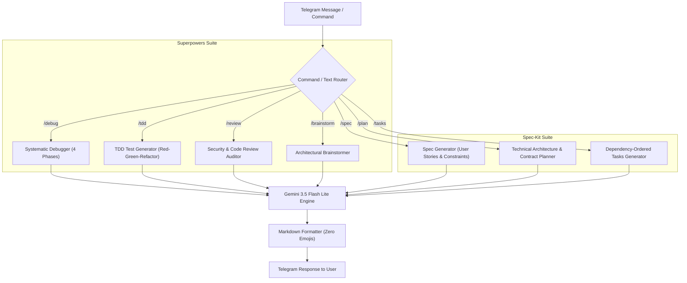

# Technical Specification: Superpowers & Spec-Kit Skills for Telegram Agent

**Document ID:** `SPEC-2026-TG-SUPERPOWERS-003`  
**Date:** 2026-11-07  
**Status:** APPROVED FOR IMPLEMENTATION  

---

## 1. Executive Summary

This specification defines the integration of Superpowers engineering methodologies and GitHub Spec-Kit workflow capabilities directly into the personal Telegram AI bot (`@Sharif_1st_Agent_bot`).

The goal is to empower the user to execute professional software engineering, architectural planning, systematic debugging, test-driven development (TDD), and spec-driven workflows directly from Telegram.

---

## 2. Capabilities & Methodologies

### Category A: Superpowers Engineering Skills
1. **Systematic Debugger (`/debug <code_or_error>`):**
   - Implements the 4-phase debugging methodology:
     * Phase 1: Problem Definition & Error Tracing
     * Phase 2: Root Cause Isolation (Hypothesis & Evidence)
     * Phase 3: Minimal Fix Formulation
     * Phase 4: Prevention & Verification Strategy
   - Strict ban on guesswork or speculative patching.

2. **Test-Driven Development Generator (`/tdd <function_or_spec>`):**
   - Implements strict Red-Green-Refactor testing protocol:
     * Step 1 (Red): Generates failing unit tests (PyTest / Jest / unittest).
     * Step 2 (Green): Provides minimal passing implementation.
     * Step 3 (Refactor): Delivers clean, optimized, production-grade code.

3. **Code Review & Security Auditor (`/review <code_snippet>`):**
   - Audits code against OWASP Top 10 security risks (SQLi, XSS, token leakage).
   - Evaluates performance bottlenecks, time/space complexity, and memory leaks.
   - Recommends clean code refactorings adhering to SOLID and DRY principles.

4. **Deep Architectural Brainstormer (`/brainstorm <idea_or_feature>`):**
   - Explores technical trade-offs, architecture patterns (Monolith vs Microservices, Event-Driven).
   - Generates database schema concepts, API contract recommendations, and edge-case risk matrices.

---

### Category B: Spec-Kit SDD Skills
1. **Spec Generator (`/spec <feature_description>`):**
   - Drafts standard GitHub Spec-Kit `spec.md` with:
     * User Stories & Acceptance Criteria (Given-When-Then)
     * Functional Requirements & Non-Functional Constraints
     * Boundary Conditions and Out-of-Scope definitions.

2. **Technical Plan Generator (`/plan <spec_or_idea>`):**
   - Drafts standard GitHub Spec-Kit `plan.md` with:
     * System Architecture & Data Flow
     * Data Contracts & Schemas (YAML / JSON)
     * Security & Performance Guidelines.

3. **Task Checklist Generator (`/tasks <plan_or_spec>`):**
   - Generates actionable, prioritized, dependency-ordered tasks (`tasks.md`) with checkable format `[ ] Task: Description`.

---

## 3. Architecture & Data Flow

---

## 4. Implementation Details

1. `agent_tools.py`:
   - Implement `systematic_debug(code_or_error: str) -> str`
   - Implement `generate_tdd_suite(requirement: str) -> str`
   - Implement `review_code_security(code: str) -> str`
   - Implement `brainstorm_architecture(idea: str) -> str`
   - Implement `generate_speckit_spec(feature_idea: str) -> str`
   - Implement `generate_speckit_plan(spec_or_idea: str) -> str`
   - Implement `generate_speckit_tasks(plan_or_idea: str) -> str`

2. `bot.py`:
   - Register CommandHandlers: `/debug`, `/tdd`, `/review`, `/brainstorm`, `/spec`, `/plan`, `/tasks`.
   - Update `system_instruction` so Gemini naturally handles these workflows in conversational chat.
   - Update `/start` menu to display all new Superpowers and Spec-Kit commands.

3. Quality Assurance:
   - Strict adherence to Zero-Emoji Policy across all prompts and templates.
   - Verify all modules compile with Python syntax verification.
   - Containerized integration test in Docker.
   - Git commit and push to remote repository.
